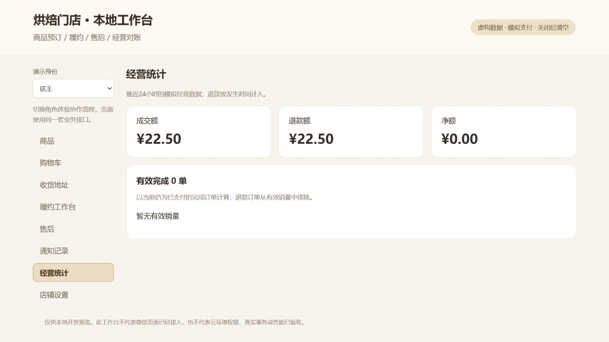
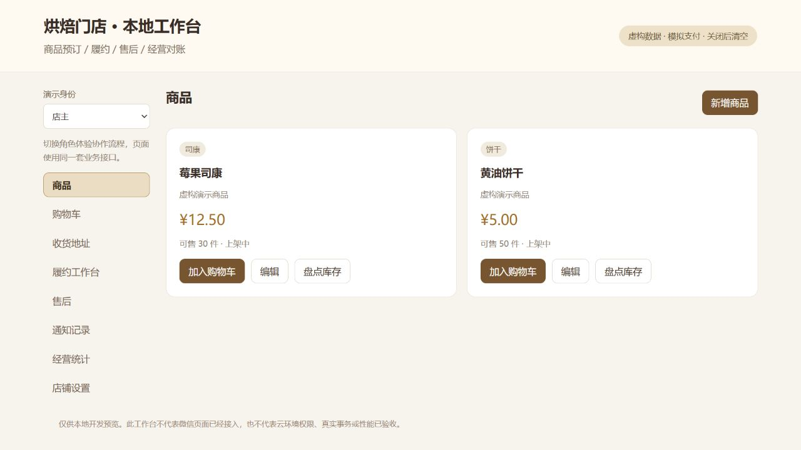

# 全组离线模块验收记录

日期：2026-10-26。代码运行于电脑已有Node.js，无新增第三方依赖或软件安装。范围是领域模块、公共客户端、内存事务及仅本机演示HTTP工作台。

## 自动测试

当前233项通过，0失败、0跳过。原始输出：[local-workflows-20261026.tap](local-workflows-20261026.tap)。旧163项回归保留，本轮先新增48项形成211项，再追加结算恢复12项、微信缓存适配10项：

| 文件 | 新增数 | 验证 |
|---|---:|---|
| customer-services.test.js | 13 | 商品、库存保护、地址归属/默认/软删除、购物车估算与版本 |
| fulfillment-aftersale.test.js | 12 | 配送、自取、核销、时间线、申请审核退款、失败恢复与竞争 |
| statistics-query.test.js | 7 | 财务口径、跨页205笔记录、跨期退款、有效销量、游标/适配检查 |
| shop-workflow-integration.test.js | 4 | 公共客户端贯通顾客/店员/店主的主线与越权 |
| shop-notification.test.js | 8 | 运费配置、事务通知、退避、租约竞争和确认失败恢复 |
| local-workbench.test.js | 4 | 本机HTTP、静态脚本语法、演示身份、来源/Host/请求限制 |
| checkout-recovery.test.js | 12 | 刷新恢复、响应丢失、存储失败、身份隔离、新旧意图冲突及不保存凭据 |
| wechat-checkout-storage.test.js | 10 | 模拟微信同步缓存、对象隔离、配额/读取异常、损坏值、环境/主体隔离及恢复贯通 |

`npm test`自动发现test/*.test.js，使用独立Node测试进程；不再需要每增加文件就修改长文件列表。根目录没有npm依赖安装步骤。

## 本地流程演示

`npm run demo:workflows`已运行：配送3500分完成、自取1250分完成、另一个订单售后退款2500分。对账成交7250分、退款2500分、净额4750分，有效完成2单/销量3件。测试发送器处理16个通知事件，没有发送外部消息。

## 浏览器手工回归

通过本机工作台实际操作，而非直接改内存数据：

1. 商品加购、购物车估算、服务端报价、人工确认提交、模拟支付。
2. 店员接单和准备自取，顾客仅能取本人核销码，店员输入后完成；统计显示成交/净额12.50元、有效完成1单。
3. 在重启后的独立会话新增唯一默认地址，创建一件商品的配送订单（12.50元+运费10元），申请售后、店主批准和执行模拟退款；统计显示成交22.50元、退款22.50元、净额0。
4. 修复内置浏览器不支持prompt的问题，所有核销/物流/原因输入改为页面内表单；修复角色切换期间旧请求覆盖界面的竞态，切换/提交时暂禁交叉操作，渲染绑定当前身份和请求批次。

上述手工检查不计入自动测试数。浏览器截图来自第3步的虚构会话，与命令行演示为不同进程/数据集，金额不同是预期的。

追加手工检查：保存12.50元的结算报价后刷新，回到购物车能恢复原请求和原金额；确认创建后再刷新、恢复，只显示同一张原订单，购物车保留供核对。未在真实微信页面验证。

## 仍未完成的验收

原微信页面尚未切换新客户端；未验证微信开发者工具编译/真机、真实微信身份、云函数入口、真实数据库事务/查询/规则/索引、云定时任务、文件存储、微信冷启动恢复或50并发/2秒响应。微信缓存封装已通过模拟API贯通，未实测基础库或真机配额行为。浏览器刷新恢复已验证；物流是手工登记，支付退款是模拟，通知是测试发送器。

MemoryRepository使用理想串行快照；query契约新增后生产适配仍需实现，不能拿这些用例宣称实际分布式不超卖或数据库吞吐达标。初始化和迁移预检仍没有在真实环境执行。
