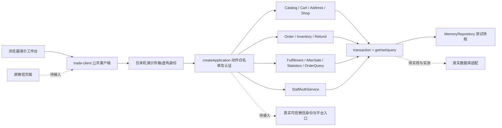
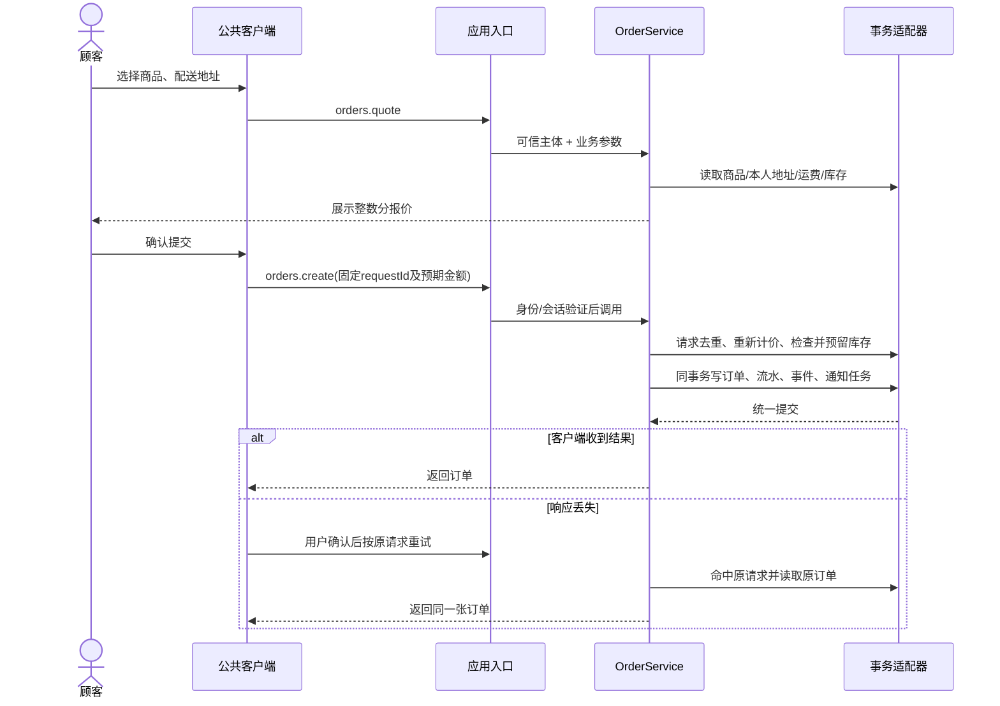
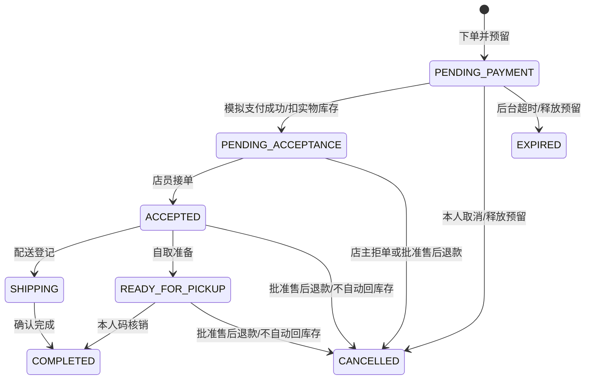
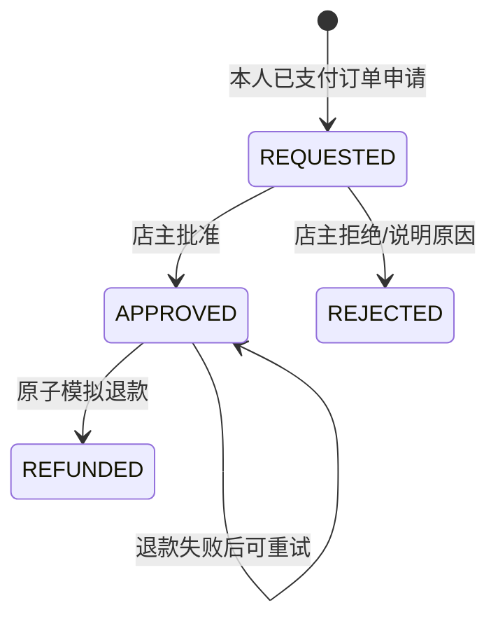

# 本地实现对应的架构与业务模型

日期：2026-10-26。图对应当前代码，不是云部署图；可作为报告设计部分的素材，仍需团队核对并结合实际部署更新。

```mermaid
classDiagram
  class CatalogService {
    +list(actor,input)
    +get(actor,id,options)
    +save(actor,input)
  }
  class AddressService {
    +list(actor,input)
    +save(actor,input)
    +remove(actor,input)
  }
  class CartService {
    +get(actor)
    +setLine(actor,input)
    +clear(actor,input)
  }
  class OrderService {
    +quote(actor,input)
    +create(actor,input)
    +simulatePay(actor,id,options)
    +cancel(actor,id,options)
    +expire(actor,id,options)
  }
  class FulfillmentService {
    +act(actor,action,input)
    +pickupCode(actor,id)
  }
  class AfterSaleService {
    +apply(actor,input)
    +review(actor,input)
    +get(actor,id,options)
    +list(actor,input)
  }
  class RefundService {
    +refundApproved(actor,id,options)
    +rejectOrder(actor,input)
  }
  class StatisticsService {
    +summary(actor,range)
  }
  class ShopService {
    +get(actor)
    +save(actor,input)
  }
  class StaffAuthService {
    +login(subject,password)
    +resolveActor(subject,token)
    +logout(subject,token)
    +setPassword(actor,subject,password)
    +setStaffAccess(actor,subject,enabled)
  }
  class TransactionRepository {
    +transaction(work)
  }
  CatalogService --> TransactionRepository
  AddressService --> TransactionRepository
  CartService --> TransactionRepository
  OrderService --> TransactionRepository
  FulfillmentService --> TransactionRepository
  AfterSaleService --> TransactionRepository
  RefundService --> TransactionRepository
  StatisticsService --> TransactionRepository
  ShopService --> TransactionRepository
  StaffAuthService --> TransactionRepository
```

TransactionRepository在图中是契约，不是仓库里额外虚构的实现类。当前适配为test/support/memory-repository.js，生产适配尚未实现。商品编辑不调用库存扣减；订单事务、退款事务和库存调整分别维护库存不变量。

模拟支付失败保留待支付状态；已配送/完成订单退款时保留物流主状态，仅paymentStatus改REFUNDED。售后批准后冻结后续履约，避免退款失败期间继续发货。售后拒绝后新申请生成新售后单，不让旧售后状态倒退。

详细字段、统计口径和查询契约见[全组接口与数据契约](本地全组接口与数据契约.md)。上述图说明本地实现的职责，不能证明真实数据库串行化、身份验证、权限配置、网络或50并发用户性能已完成。
