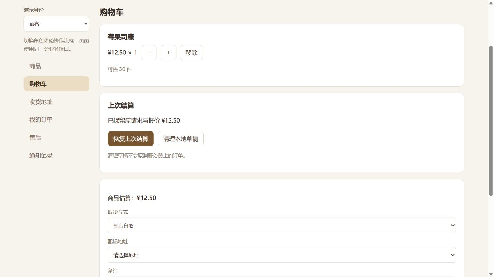

# 刷新后的结算恢复

日期：2026-10-26。模块services/checkout-recovery.js可组合公共客户端与本地存储，不依赖微信/云SDK。浏览器工作台已接localStorage；另已提供微信本地存储适配及模拟API贯通测试，原微信页面仍未接入。

## 接入

```js
const { createCheckoutRecovery } = require('../../services/checkout-recovery');
const actor = await client.identity.me();
const recovery = createCheckoutRecovery({
  client,
  subjectId: actor.openid,
  storage: {
    get: key => readDecodedLocalObject(key), // 返回对象或null，可同步或Promise
    set: (key, object) => writeLocalObject(key, object),
    remove: key => removeLocalObject(key)
  }
});

const draft = await recovery.prepare({
  requestId: newRequestIdForThisCheckout,
  items: [{ productId: 'bread', quantity: 2 }], deliveryType: 'pickup'
});
// 展示draft.quote，让顾客确认，再执行：
const order = await draft.submit();
```

上述三个存储函数可由平台自行提供；微信项目也可使用下方新增封装。prepare先持久化原请求和报价，不自动下单；重新打开页面时调用restore获得草稿，再让用户核对后submit/retry。restore不重新报价或生成新请求ID。

## 微信本地存储适配

```js
const { createWechatCheckoutStorage } = require('../../services/wechat-checkout-storage');
const { createCheckoutRecovery } = require('../../services/checkout-recovery');
// client必须先接入可信身份及统一业务接口；本封装不提供云传输或登录。
const actor = await client.identity.me();
const namespace = 'bakery.checkout.test.v1'; // 测试/生产使用不同的固定命名空间
const recovery = createCheckoutRecovery({
  client, subjectId: actor.openid, namespace,
  storage: createWechatCheckoutStorage({ wx, subjectId: actor.openid, namespace })
});
const recovered = await recovery.restore();
// 有草稿时先展示recovered.quote并请顾客核对，再调用recovered.submit()。
```

模块加载时不访问全局wx，四个同步存储方法通过参数注入。每份适配器只操作指定命名空间及主体的一个键，删除草稿不会清空购物车或其他缓存。主体必须来自可信接口，不能直接相信旧页面缓存中的openid或角色标记。

先检查缓存键清单再读取，区分“确实没有草稿”和“读取失败/已存在但损坏”。平台异常转换为CHECKOUT_STORAGE_ERROR，不显示底层异常；已存在的空值按损坏草稿处理，防止覆盖可能结果未知的旧请求。业务操作不自动清缓存，也不调用云函数。

开发参考：[腾讯存储概述](https://intl.cloud.tencent.com/ind/document/product/1219/61746)、[微信getStorageInfoSync](https://developers.weixin.qq.com/miniprogram/dev/api/storage/wx.getStorageInfoSync.html)。本轮微信API页面抓取失败，适配器按同步存储接口契约实现并用模拟API验证；最终基础库兼容性、存储配额及冷启动需要在开发者工具/真机验收。

新增10项测试覆盖键/环境隔离、对象副本、平台异常、损坏值、重建恢复、提交后丢响应及存储写失败。这里只证明适配逻辑与业务核心贯通，不能宣称原微信页面已经接好或真实冷启动通过。账号切换后必须丢弃旧恢复管理器，用新主体重建。

inspect返回状态、请求ID、已知订单ID和金额摘要。CONFIRMED记录的submit只调用orders.get读取最新订单，不再次创建；UNCERTAIN/SUBMITTING记录按原请求创建接口恢复，由服务端去重返回原订单。调价仍返回PRICE_CHANGED，必须人工准备新请求和新报价。

## 状态和约束

| 状态 | 含义 |
|---|---|
| PREPARED | 请求/报价已保存，尚未发送创建 |
| SUBMITTING | 发送前已经保存；中断后结果可能未知 |
| UNCERTAIN | 网络或响应异常，创建结果待确认 |
| CONFIRMED | 已取得订单ID，恢复时只查订单 |
| REJECTED | 已知业务拒绝，用户可确认新意图 |

发送前存储失败会阻止创建；创建成功后本地确认记录写失败仍返回已知订单，并在getRecoveryStatus中提示storageWarning。此时旧存储仍有原请求，刷新后依然能按相同参数恢复。

结果未知时，新的requestId不能覆盖原草稿，返回CHECKOUT_RECOVERY_REQUIRED。同请求ID改变商品/配送/备注也会拒绝。旧草稿被新意图替换后不能再提交，重复点击在同一实例内共用一次请求。

只保存白名单业务数据、报价、主体绑定及订单ID，不保存口令、员工令牌、actor或角色标记。每次操作通过identity.me核对当前主体；这用于防止恢复错账号草稿，不能替代服务端身份认证。账号切换时仍须销毁旧客户端、恢复管理器与页面中的旧意图。

discard只删除本地草稿，**不会取消服务器订单**。未知结果或损坏记录需要明确传acknowledgeUncertain:true后才允许清理；页面应先提示核对订单。存储不可读时仍返回存储错误，不声称已经清理。

## 浏览器工作台

`npm run preview:local`后，顾客在购物车核对金额，再刷新页面；回到购物车可点击“恢复上次结算”。已确认订单会直接回到原订单列表，尚未确认的草稿重新展示原报价，由用户确认。

恢复后的订单不自动清空当前购物车，避免清掉页面中断后新添加的商品；由用户核对。店主/顾客各按主体隔离草稿。演示进程每次启动有新的instanceId，草稿命名空间也改变，避免把旧进程的内存订单误当成持久化数据库中的订单。



本批12项自动测试，覆盖响应丢失、重建客户端、存储失败、身份切换、旧草稿替换、重复点击、调价及不保存凭据。浏览器也已实测报价后刷新恢复、创建后刷新只查询同一订单；手工检查不计入自动测试数量。

## 边界

该协议按单个客户端实例串行化操作，不提供跨标签页原子锁。真实跨进程/跨设备仍依赖服务端requestId去重；真实小程序冷启动、平台存储配额/失效、草稿过期清理和生产数据库恢复仍需单独验证。业务备注等也是用户数据，生产存储与保留策略由团队明确；不要把草稿当作完整订单备份。
