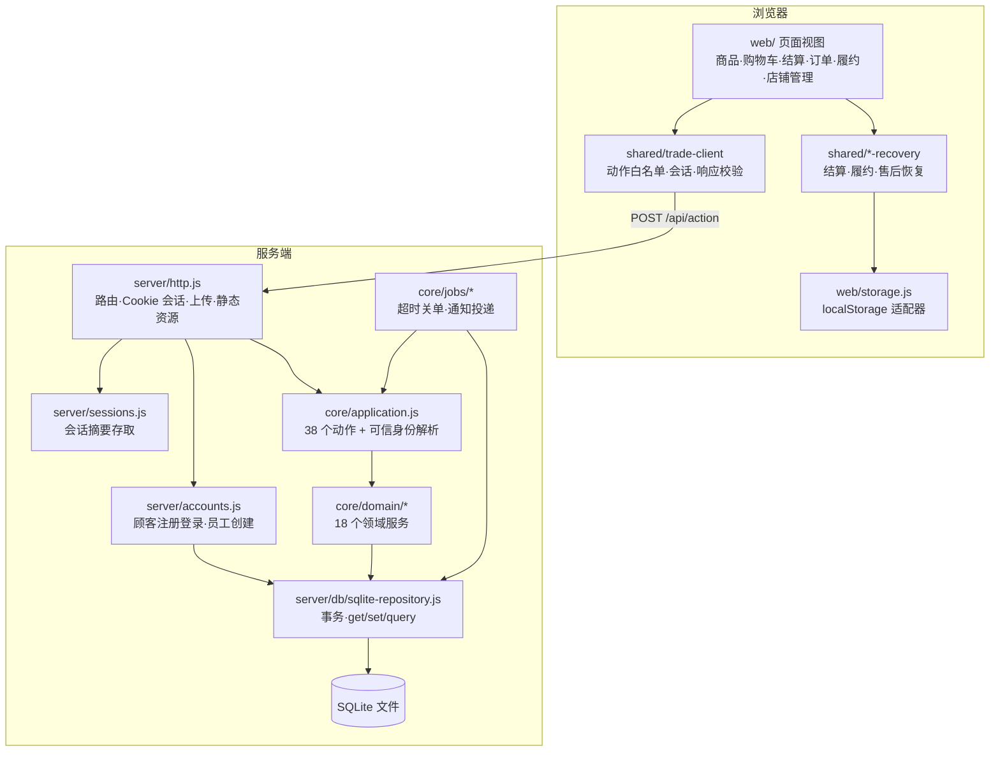
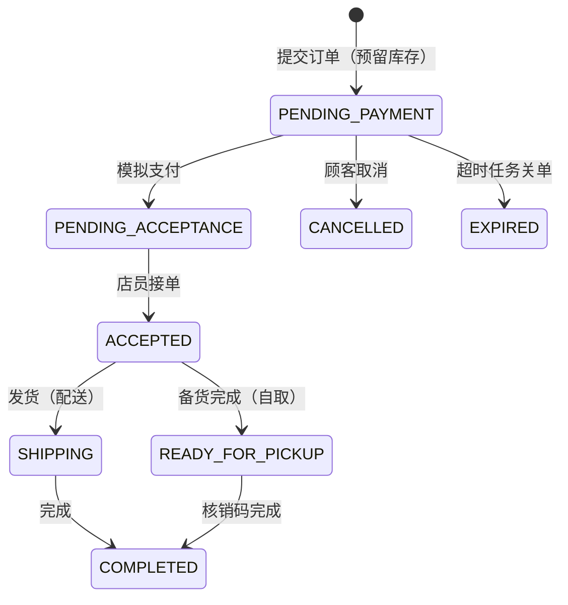

# 网页端架构与业务模型

对应代码：`core/`（业务核心）、`shared/`（共用客户端）、`server/`（运行时）、`web/`（页面）。
可作为报告"系统设计"章节的素材，需按最终代码再核对。

## 一、分层

关键约束：

- **业务核心不感知传输**：`core/` 只依赖 `repository.transaction()` 和注入的 `resolveIdentity`，
  不导入 HTTP、Cookie、数据库驱动或任何平台 API。
- **传输层只做身份翻译**：`server/http.js` 把 Cookie 解析成可信 `openid` 与员工令牌，
  请求体里的身份字段一律不采信。
- **客户端只有一份**：浏览器通过 `/api/client.js` 拿到由 `shared/` 现场生成的 SDK，
  与 Node 测试、验收脚本使用完全相同的代码。

## 二、角色与权限

| 角色 | 身份来源 | 能做什么 |
|---|---|---|
| 顾客 `customer` | 自助注册，用户名 + scrypt 口令 | 商品、购物车、地址、下单、模拟支付、取消、售后申请 |
| 店员 `staff` | 店主创建，口令 ≥12 位 | 履约：接单、发货、备货、自取核销 |
| 店主 `owner` | 首次启动初始化 | 全部 + 商品库存、店铺运费、售后审核与退款、统计、员工账号 |
| 系统 `system` | 仅限服务端后台任务 | 超时关单 |

角色判定在 `core/domain/auth.js`：`requireActor` 要求员工角色带 `staffVerified`，
而 `staffVerified` 只能由 `StaffAuthService.resolveActor` 用有效员工会话得出。
浏览器里隐藏按钮只是体验优化，真正的边界在服务端。

## 二点五、数据可见性（多人共用一个部署时的边界）

数据都放在同一个库里（单店系统），但"谁能看到什么"由服务端判定，前端隐藏只是体验。
规则集中在 `core/domain/auth.js` 的 `requireOwner` / `requireRole`，以及各服务列表查询里的
`ownerOpenid` 过滤。

| 数据 | 顾客 | 店员 | 店主 |
|---|---|---|---|
| 自己的订单 | 可见 | — | — |
| 全部订单 | 不可见（`FORBIDDEN`） | 可见（`manage: true`） | 可见（`manage: true`） |
| 他人的订单详情/时间线/支付/取消 | 不可见（`FORBIDDEN`） | 可见 | 可见 |
| 收货地址 | 只自己的 | 不可见 | 不可见 |
| 购物车 | 只自己的（按 openid 派生键） | — | — |
| 售后申请 | 只自己的 | 可见 | 可见 |
| 自取核销码 | 只下单顾客 | 不可查（需顾客到店报码） | 同店员 |
| 商品与库存 | 可见 | 可见 | 可见（含下架与预留数） |
| 经营统计 | 不可见 | 不可见 | 可见 |
| 员工账号管理 | 不可见 | 不可见 | 可见 |

要点：

- **库存是共享状态**：别人下单会把 `reserved` 加上去，可售数量对所有人同步减少 —— 这是单店应有的行为，
  也是并发验收要证明的东西（50 人抢 10 件，恰好 10 单成交）。
- **订单是私有数据**：只有下单顾客本人和店家（店员/店主）能看到，其他顾客拿到订单号也读不出来。
- 这些规则由 `test/isolation.test.js`（11 项）和 `test/server-http.test.js`
  里的 HTTP 用例固定住，改动权限逻辑会直接测试失败。

## 三、核心业务模型

配套不变量：

| 领域 | 不变量 | 实现位置 |
|---|---|---|
| 库存 | `onHand ≥ reserved ≥ 0`，可售 = `onHand − reserved` | `domain/inventory.js` |
| 下单 | 提交时预留库存；支付时扣减实物库存并释放预留 | `domain/order-service.js` |
| 计价 | 全部金额按"分"为整数；运费按省份分档，满额包邮 | `domain/pricing.js` |
| 幂等 | 同一 `requestId` 重复提交返回原结果，不重复扣减 | `domain/service-utils.js` 的 `once()` + `request_keys` |
| 并发 | 写操作带 `expectedVersion` 乐观锁；库存变更升版本 | 各服务 `version()` 校验 |
| 审计 | 订单、售后、店铺、库存变更都写事件集合 | `domain/transaction-log.js` |
| 退款 | 只能退已支付且未退过的订单；按订单整单退 | `domain/refund-service.js` |

## 四、一次下单的数据流

1. 浏览器 `shared/trade-client` 发出 `{ action: 'orders.create', data }`。
2. `server/http.js` 用 Cookie 解析出 `openid`，连同 `staffToken` 一起交给 `core/application.js`。
3. `application.handle` 调 `OrderService.create`，在一个 SQLite 事务里：
   读商品与地址 → 校验计价与库存 → `reserved += qty` → 写订单 → 写幂等键 → 写订单事件。
4. 事务提交后返回完整订单对象；客户端校验 `requestId` 与金额一致才认账。
5. 任一步失败整体回滚，库存与幂等键不会留下半截状态。

## 五、与迁移前的差异

| 方面 | 迁移前（小程序） | 现在（网页端） |
|---|---|---|
| 身份 | 微信 openid 免登录 | 用户名 + scrypt 口令 + HttpOnly 会话 Cookie |
| 数据 | 云开发文档数据库 | SQLite 文件，真实事务与表达式索引 |
| 传输 | 云函数 `callFunction` | Node HTTP `POST /api/action` |
| 页面 | WXML + `Page/setData` | 浏览器原生 ES 模块，零构建 |
| 存储 | `wx.setStorageSync` | `web/storage.js` 的 localStorage 适配器 |
| 部署 | 微信开发者工具 + 云环境 | `node server/index.js` 单进程 |